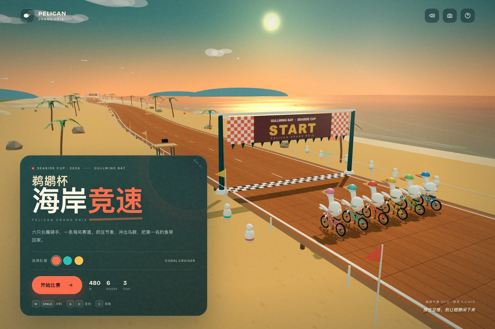
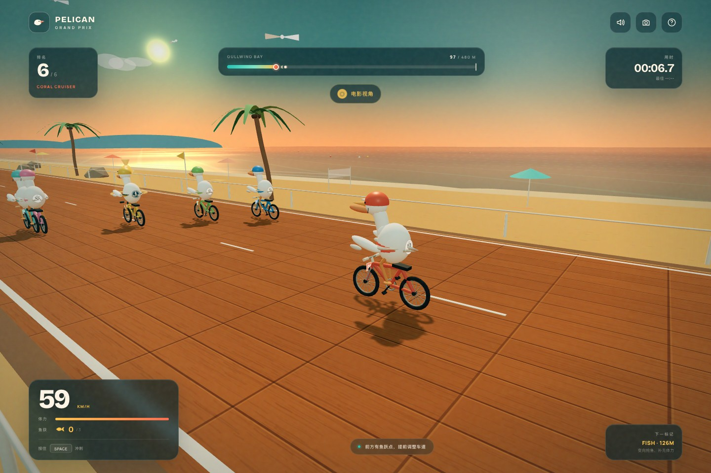
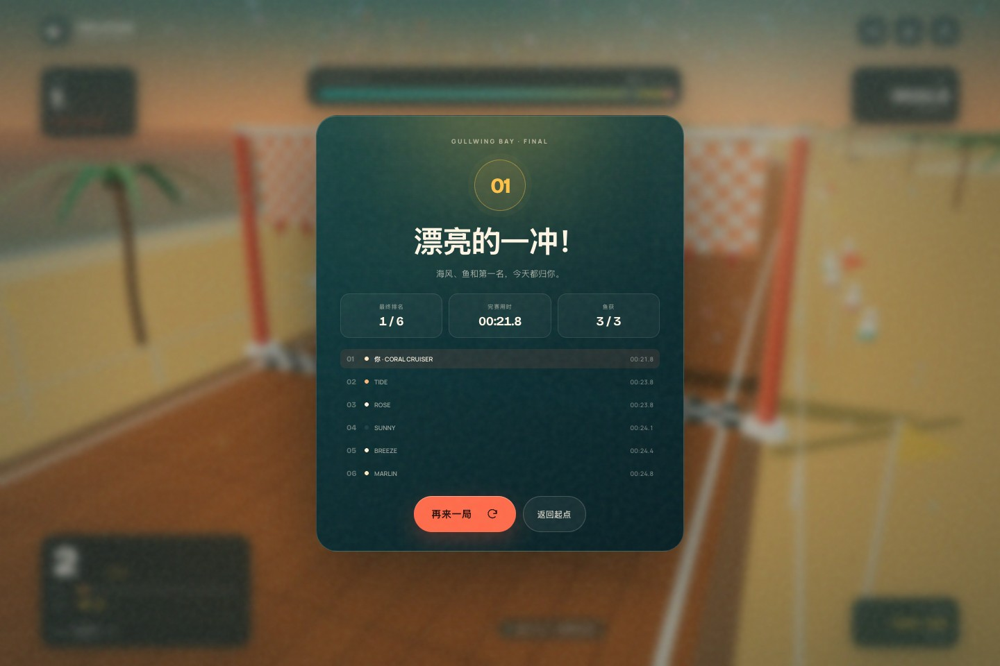

# 鹈鹕杯 · 海岸竞速

一个用 Three.js 制作的 3D 海岸自行车竞速小游戏：六只戴头盔的鹈鹕，在海边木栈道上一决高下。



## 开始

```bash
npm install
npm run dev
```

打开终端里显示的本地地址即可游玩。

生产构建：

```bash
npm run build
npm run preview
```

## 玩法

- **W / Space / ↑**：按住冲刺，消耗体力；松开恢复体力。
- **A / D 或 ← / →**：左右变向。
- **C**：切换追尾 / 电影视角。
- **M**：打开或关闭声音。
- 赛道上有 **3 个发光鲭鱼**，穿过它们可以获得一次爆发加速并补充体力。
- 在 480 米赛道中超过其他五只鹈鹕，冲过终点。成绩会保存在本地。

手机端会自动显示触控按钮，支持横屏和竖屏。

## 特性

- 完全程序化建模：鹈鹕、单车、棕榈树、海面、云和观众，没有外部模型依赖。
- 带波浪着色器的海面、动态夕阳天空、阴影和终点彩带。
- 五名 AI 对手拥有不同速度、路线摆动和追赶策略。
- 实时排名、体力、鱼获、速度与赛道进度 HUD。
- Web Audio 合成的海浪、环境铺底、倒计时、捡鱼与冲线音效。
- 响应式 UI，支持桌面键盘与移动端触控。

## 结构

```text
src/
  main.js       # 游戏循环、状态机、输入、HUD 与相机
  world.js      # 赛道、海岸环境、海面着色器、场景装饰
  racer.js      # 程序化鹈鹕骑手和自行车模型/动画
  audio.js      # Web Audio 音效与环境声
  style.css     # 视觉系统与响应式界面
```




